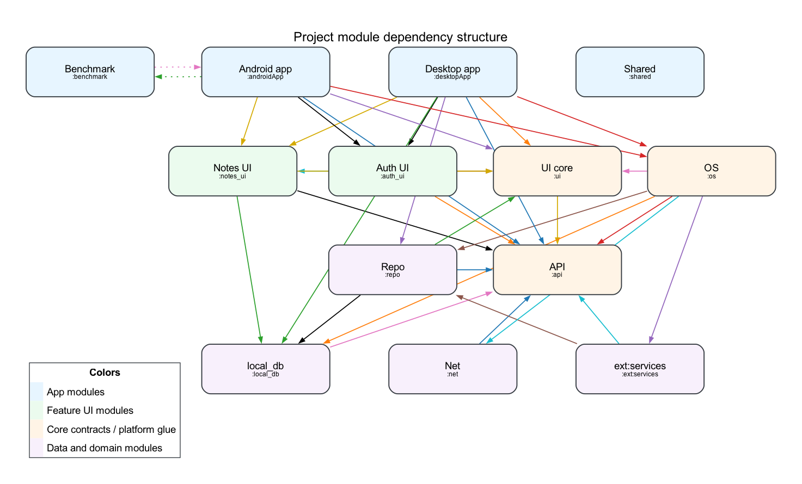
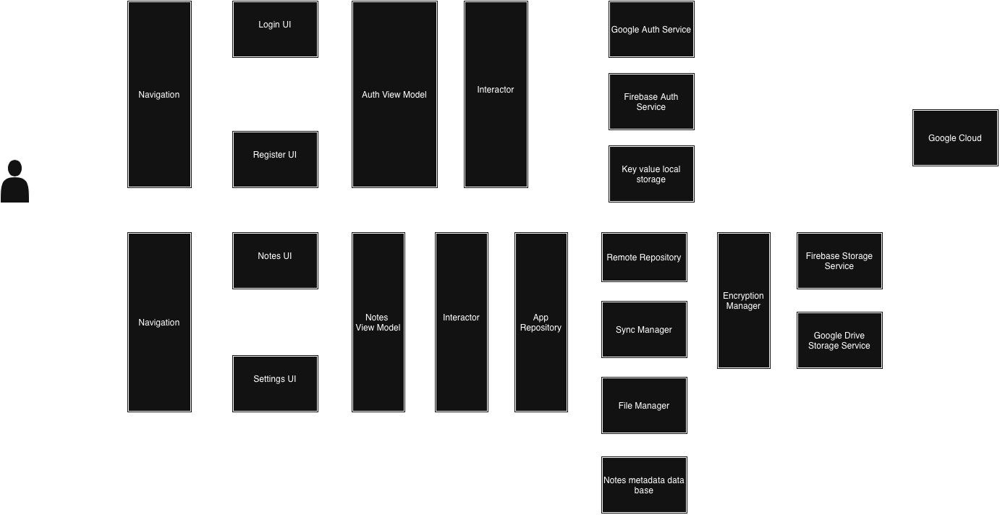

# Notes application 💜💜💜

# What is it ? ✨

Cross-platform, secure, fluent and rich editor for your notes, which is built with KMP.

# Current state

Under active development.

# Design

# High level app architecture

**The ongoing tasks**

1. Investigate memory issues during runtime

2. Test with large notes > 1 GB

3. Implement UI improvements (Search, Labels ...)

4. Can add PlayIntgrity check using Firebase. However, it needs Google Play console configuration which is not possible now.
