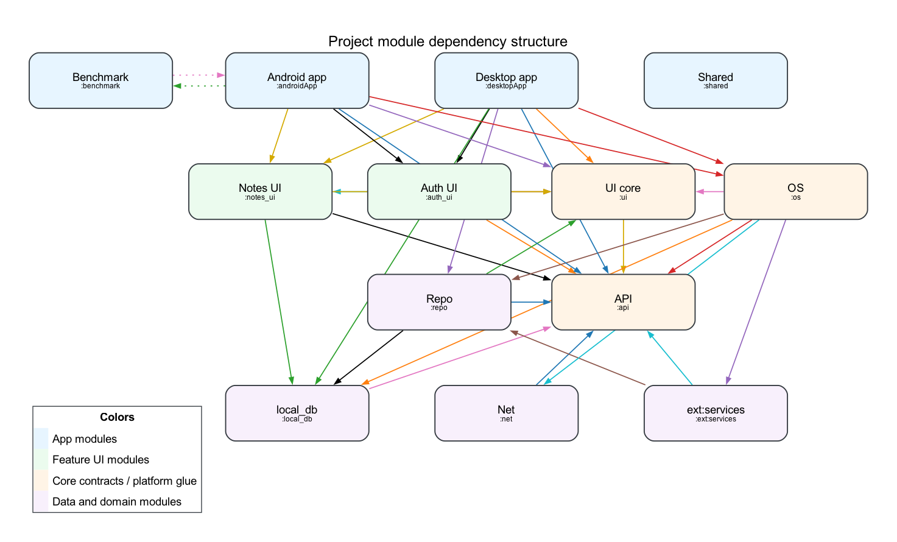
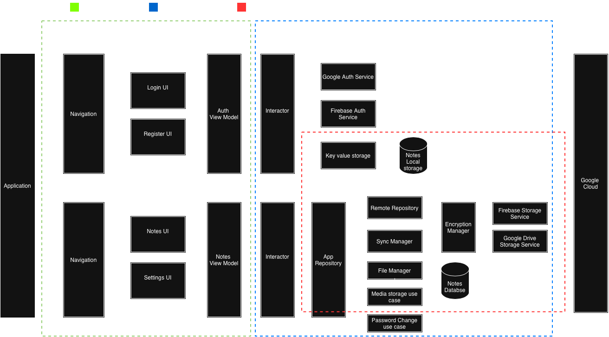

# Notes application 💜💜💜

# What is it ? ✨

Cross-platform, secure, fluent and simple rich editor for your notes, which is built with KMP.

# Current state

| Platform | Support Status | Target |
| :--- | :---: | :--- |
| **Android** | ✅ Supported | API Level 26+ |
| **Desktop (JVM)** | ✅ Supported | macOS |
| **iOS** | ⚠️ Supported | Early development |

# Design

# High level app architecture

**The ongoing tasks**

1. Investigate memory issues during runtime

2. Test with large notes > 1 GB

3. Implement UI improvements (Search, Labels ...)

4. Can add the PlayIntgrity checks throught Firebase SDK. However, it needs Google Play console configuration which is not possible now.
